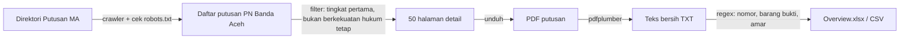

<div align="center">

# ⚖️ Dataset-Narkotika_399

### Korpus Putusan Pengadilan Negeri Banda Aceh — Pidana Khusus Narkotika dan Psikotropika


*Dataset ini disusun untuk keperluan akademik pada mata kuliah **Temu Kembali Informasi (Information Retrieval)**,
Fakultas Teknik, Universitas Muhammadiyah Malang, Semester Ganjil 2026/2027.*

</div>

---

## 📖 Ringkasan

Putusan pengadilan adalah dokumen hukum yang terbuka untuk publik dan sangat kaya secara tekstual: ada identitas terdakwa,
dakwaan, tuntutan, pertimbangan hakim, hingga amar putusan. Karakter inilah yang menjadikannya bahan yang baik untuk
eksperimen **pencarian (search engine)**, **ekstraksi informasi**, dan **pengindeksan teks** pada domain hukum berbahasa Indonesia.

Repository ini berisi **50 dokumen putusan tingkat pertama dari Pengadilan Negeri Banda Aceh** pada klasifikasi
*Pidana Khusus → Narkotika dan Psikotropika*, beserta tabel ringkasan (`Overview.xlsx`) yang memuat
nomor putusan, lembaga peradilan, barang bukti, dan amar putusan setiap dokumen.

| | |
|---|---|
| **Sumber** | [Direktori Putusan Mahkamah Agung RI](https://putusan3.mahkamahagung.go.id/direktori.html) |
| **Direktori / Klasifikasi** | Pidana Khusus → Narkotika dan Psikotropika |
| **Pengadilan** | PN Banda Aceh |
| **Rentang tahun putusan** | `<<ISI: mis. 2023–2025>>` |
| **Jumlah dokumen** | 50 berkas PDF |
| **Tingkat proses** | Pertama (bukan banding/kasasi) |
| **Status putusan** | Tidak berstatus *berkekuatan hukum tetap* |
| **Pengumpul** | Muhammad Shaumi Rayyanullah (NIM 202310370311399) |

## 🗂️ Struktur Repository

```text
Dataset-Narkotika_399/
├── Dataset/
│   └── Narkotika.zip          # 50 dokumen putusan (*.pdf)
├── Overview/
│   └── Overview.xlsx          # ringkasan 50 putusan (No, No Putusan, Lembaga, Barang Bukti, Amar)
└── README.md                  # dokumentasi ini
```

## 🧾 Kamus Data (`Overview/Overview.xlsx`)

| Kolom | Tipe | Penjelasan |
|---|---|---|
| `No` | integer | Nomor urut 1–50 |
| `No Putusan` | string | Nomor perkara, mis. `63/Pid.Sus/2024/PN Bna` (nomor / jenis perkara / tahun / kode pengadilan) |
| `Lembaga Peradilan` | string | Pengadilan yang memutus (`PN Banda Aceh`) |
| `Barang Bukti` | teks | Daftar barang bukti pada butir amar *“Menetapkan barang bukti berupa …”* (jenis narkotika, berat, alat timbang, telepon genggam, dsb.) |
| `Amar Putusan` | teks | Seluruh butir amar setelah kata **MENGADILI** hingga sebelum *“Demikianlah diputuskan …”* |

> Berkas CSV hasil ekstraksi lengkap (`hasil_ekstraksi_putusan_narkotika.csv`) menambahkan kolom nama terdakwa,
> tuntutan Penuntut Umum, pasal, pidana penjara, denda, subsider, jenis narkotika, berat barang bukti, dan tanggal putusan.

## 🔬 Bagaimana Dataset Dikumpulkan



**Kriteria seleksi**

1. Direktori **Pidana Khusus**, klasifikasi **Narkotika dan Psikotropika**.
2. Satu pengadilan saja: **PN Banda Aceh** (tidak sama dengan pengadilan yang dipakai kelompok lain).
3. Rentang tahun putusan yang direkomendasikan: 2023–2025.
4. Hanya putusan **tingkat pertama**; putusan banding (PT) dan kasasi tidak dimasukkan.
5. **Tidak** memakai putusan berstatus *berkekuatan hukum tetap*.
6. Hanya putusan yang menyediakan berkas PDF.

**Etika dan kepatuhan crawling:** pengambilan data memeriksa `robots.txt`, memakai jeda acak 2–4 detik antar-permintaan,
dan hanya mengakses halaman direktori publik. Kode lengkapnya ada pada notebook crawler (lihat bagian *Tautan*).

## 📊 Statistik Dataset

> Isi tabel berikut dari keluaran sel terakhir notebook crawler (bagian *Statistik dataset*).

| Ukuran | Nilai |
|---|---|
| Jumlah dokumen | 50 |
| Distribusi per tahun putusan | `<<ISI>>` |
| Jenis narkotika pada barang bukti (sabu / ganja / ekstasi / lainnya) | `<<ISI>>` |
| Rata-rata panjang teks per putusan | `<<ISI>>` karakter |
| Dokumen dengan amar dan barang bukti terekstrak | `<<ISI>>` / 50 |

## 🚀 Cara Memakai

**Membaca ringkasan**

```python
import pandas as pd
df = pd.read_excel("Overview/Overview.xlsx")
print(df.head())
print(df["Lembaga Peradilan"].value_counts())
```

**Mengekstrak dan membaca seluruh PDF**

```python
import zipfile, pdfplumber

with zipfile.ZipFile("Dataset/Narkotika.zip") as z:
    z.extractall("putusan_pdf")

with pdfplumber.open("putusan_pdf/01_xxx.pdf") as pdf:
    teks = "\n".join(p.extract_text() or "" for p in pdf.pages)
print(teks[:500])
```

**Mengunduh langsung dari Google Colab (tanpa login)**

```python
import requests
url = "https://github.com/<USERNAME>/Dataset-Narkotika_399/raw/main/Dataset/Narkotika.zip"
open("Narkotika.zip", "wb").write(requests.get(url).content)
```

## 💡 Ide Pemanfaatan

- **Mesin pencari putusan** (TF-IDF, BM25, hibrida dengan embedding) — lihat notebook Soal 4.
- **Ekstraksi informasi** (barang bukti, pidana, denda, pasal) dengan regex atau NER.
- **Klasifikasi** jenis narkotika atau rentang pidana dari teks putusan.
- **Peringkasan** otomatis amar atau pertimbangan hukum.
- Analisis pola *bound phrases* (frasa baku) pada bahasa putusan Indonesia.

## ⚠️ Catatan dan Keterbatasan

- Berkas PDF dari situs Mahkamah Agung sudah dianonimkan sebagian oleh pengadilan; sebagian nama dan identitas masih
  dapat muncul sebagaimana aslinya di dokumen sumber. **Gunakan hanya untuk tujuan riset/pendidikan dan hormati privasi.**
- Hasil ekstraksi berbasis *regex*; format penulisan amar antar-hakim bervariasi sehingga sebagian kecil baris dapat
  memerlukan pemeriksaan manual.
- Dataset kecil (50 dokumen) dan hanya dari satu pengadilan, sehingga **tidak representatif** untuk seluruh putusan narkotika
  di Indonesia.
- Dokumen putusan bersifat terbuka dan tidak terikat HaKI; hak atas isi putusan tetap berada pada Mahkamah Agung RI.

## 🔗 Tautan

| Berkas | Tautan |
|---|---|
| Notebook crawler & ekstraksi (Soal 2–3) | `<<ISI: link Google Colab>>` |
| Folder PDF dan TXT hasil crawling | `<<ISI: link Google Drive>>` |
| Notebook preprocessing & indexing (Soal 4) | `<<ISI: link Google Colab>>` |

## 👤 Penulis

**Muhammad Shaumi Rayyanullah** — NIM 202310370311399
Program Studi Informatika, Fakultas Teknik, Universitas Muhammadiyah Malang
Dosen pengampu: Galih W. W.

## 📚 Sitasi

```bibtex
@misc{rayyanullah2026narkotika,
  author = {Rayyanullah, Muhammad Shaumi},
  title  = {Dataset-Narkotika_399: Putusan PN Banda Aceh Pidana Khusus Narkotika dan Psikotropika},
  year   = {2026},
  note   = {Tugas UTS Temu Kembali Informasi, Universitas Muhammadiyah Malang},
  url    = {https://github.com/<USERNAME>/Dataset-Narkotika_399}
}
```
